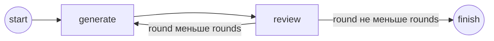

# Циклический граф Koog

Автор: Замиралов Кирилл
Библиотека: **Koog 1.3.0**. Kotlin **2.3.20**, JVM **17+**, Gradle Wrapper **9.2.0**.
Исходники библиотеки: https://github.com/JetBrains/koog/tree/1.3.0

## Запуск

Откройте папку в IntelliJ IDEA как Gradle-проект и выберите JDK 17+.
Есть два режима; граф в них один и тот же.

### Mock — без Ollama и запросов к модели

```bash
./gradlew run --args='--mock'
./gradlew run --args='--mock 1'
./gradlew run --args='--mock 5'
```

По умолчанию 3 раунда. На первых трёх раундах возвращаются три заранее заданных
ответа про граф Koog; на последующих повторяется третий ответ.
Для произвольной задачи mock-ответы остаются теми же: это воспроизводимый сценарий
для объяснения узлов и условных рёбер, а не обработка задачи моделью.
Подставляется только executor LLM; агент, сессия, узлы и переходы выполняются настоящим Koog.
Первый запуск требует интернета для Gradle и зависимостей. API-ключ и сервер Ollama не нужны.

### Ollama — настоящая локальная qwen3:8b

Существующий запуск без флага сохранён:

```bash
./gradlew run
./gradlew run --args='3 Объясни разницу между стеком и очередью'
```

Нужны запущенная Ollama на `http://localhost:11434` и установленная `qwen3:8b`:

```bash
ollama list
# Если модели нет:
ollama pull qwen3:8b
# Если сервер не запущен, откройте приложение Ollama или выполните:
ollama serve
```

Каждый раунд делает реальный запрос. Первый отвечает на задачу, следующие получают
предыдущий ответ для улучшения. Улучшение качества не гарантируется.
Подсказка `/no_think` просит Qwen отвечать без длинного рассуждения.
Если Ollama недоступна, запуск завершается ошибкой; автоматической подмены на mock нет.

### Аргументы и IntelliJ IDEA

Формат: `[--mock] [раунды 1..10] [задача]`. Флаг `--mock` ставится первым.
Число раундов по умолчанию — 3, задача по умолчанию — объяснить циклический граф Koog.
В IDEA запустите main из Main.kt. Для mock-режима укажите `--mock` в **Program arguments**
конфигурации запуска; пустые аргументы запускают Ollama.
В Windows используйте `gradlew.bat` вместо `./gradlew`.

## Сам граф



`generate` добавляет запрос в LLM-сессию, вызывает executor и создаёт новое состояние.
`review` показывает ответ и возвращает состояние. Условные рёбра выбирают повторение
или завершение по номеру раунда. Это фиксированный критерий, а не оценка качества текста.
Повторение реализовано обратным ребром Koog, а не внешним циклом вокруг агента.

Для трёх раундов в обоих режимах:

```text
start → generate → review → generate → review → generate → review → finish
```

## Файлы

- `AgentGraph.kt` — узлы, вызов LLM и рёбра. Не знает про выбор режима.
- `RunState.kt` — задача, номер раунда и последний ответ.
- `DemoAgent.kt` — выбор настройки LLM, создание и запуск агента, закрытие ресурсов.
- `LlmSetup.kt` — пара executor/model и подключение к Ollama.
- `MockLlm.kt` — заранее заданные ответы и штатный getMockExecutor Koog.
- `Main.kt` — аргументы и запуск.
- `DemoAgentTest.kt` — проверка настоящего графа с mock-ответами на 1, 3 и 10 раундах.
- `logback.xml` — скрывает DEBUG-шум библиотеки.

Для Debug поставьте breakpoint внутри generate, review или на agent.run.
Mock удобен для прохода по исходникам без ожидания генерации модели.
Диаграмма последовательности в docs/architecture показывает Ollama-режим;
в mock-режиме HTTP-участок заменяется локальным executor, графовые переходы те же.

## Проверка

```bash
./gradlew build
./gradlew run --args='--mock'
```

Тест проверяет завершение графа, передачу задачи и выбор mock-ответов, включая границы 1 и 10.
Число раундов ограничено 1..10, maxIterations=30 страхует внутренний обход.
На 5–10 раундах Ollama делает столько же реальных запросов и может работать заметно дольше.
